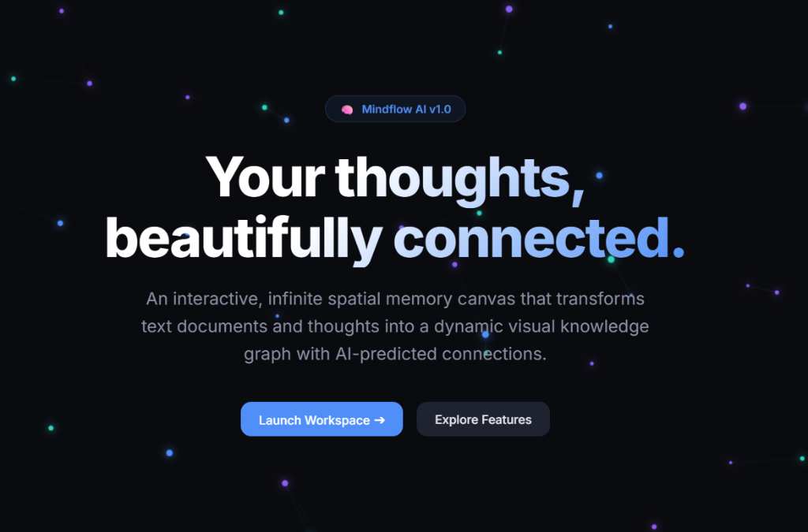

# ⚙️ MindFlow Backend — AI Vector Embeddings & Graph Routing API

> The semantic intelligence and graph database engine powering MindFlow. Orchestrates thought note persistence, spatial canvas coordinates, relationship edges, and Google Gemini vector embeddings with cosine similarity matching.

[](https://mindflow-backend-tply.onrender.com)
[](https://mindflow-frontend-bay.vercel.app/)
[](https://nodejs.org/)
[](https://expressjs.com/)
[](https://ai.google.dev/)
[](https://www.mongodb.com/)
[](LICENSE)

---

### 🌐 Live Deployments
- **REST & AI Engine API Base URL**: [https://mindflow-backend-tply.onrender.com/](https://mindflow-backend-tply.onrender.com/)
- **Visual Workspace Client**: [https://mindflow-frontend-bay.vercel.app/](https://mindflow-frontend-bay.vercel.app/)

---



---

## 📌 Overview

**MindFlow Backend** provides the computational intelligence behind the MindFlow knowledge graph. Beyond standard CRUD operations for notes, the backend integrates vector embeddings directly into the note-authoring lifecycle.

Whenever a user creates or updates a thought, the service invokes the **Google Gemini Embedding Model (`gemini-embedding-001`)** to produce a high-dimensional vector representation. It then executes vector similarity calculations to suggest associative links between isolated thoughts across the user's canvas.

---

## 🧠 AI Semantic Routing & Vector Math

### 1. Vector Generation (`generateEmbedding`)
* Every thought note's text content is converted into an embedding vector via Google's `gemini-embedding-001` retrieval model.

### 2. Cosine Similarity Calculation (`cosineSimilarity`)
* Evaluates semantic closeness between thoughts using dot-product normalized vector math:
  $$\text{Cosine Similarity}(A, B) = \frac{A \cdot B}{\|A\| \|B\|} = \frac{\sum_{i=1}^{n} A_i B_i}{\sqrt{\sum_{i=1}^{n} A_i^2} \sqrt{\sum_{i=1}^{n} B_i^2}}$$

### 3. Associative Link Prediction (`findSimilarNotes`)
* Dynamically scans the user's canvas for unconnected notes with similarity exceeding a configurable threshold ($\ge 0.30$).
* Excludes already-linked concepts and ranks suggestions from strongest to weakest connection.

---

## 🛠️ System Architecture

```text
┌─────────────────────────────────┐               HTTP REST               ┌─────────────────────────────────┐
│     MindFlow Frontend           │ <===================================> │      MindFlow Express Backend   │
│  (React 19 / Three.js 3D)       │        (Notes, Edges, AI Queries)     │    (Controllers & Express 5)    │
└─────────────────────────────────┘                                       └────────────────┬────────────────┘
                                                                                           │
                                              ┌────────────────────────────────────────────┴─────────────────┐
                                              ▼                                                              ▼
                                   ┌──────────────────────┐                                       ┌──────────────────────┐
                                   │  Google Gemini API   │                                       │     MongoDB Atlas    │
                                   │ (Embeddings: 001)    │                                       │ (Notes, Edges, Canvas│
                                   └──────────────────────┘                                       └──────────────────────┘
```

---

## 📡 REST API Reference

| Method | Endpoint | Description |
| :--- | :--- | :--- |
| `GET` | `/` | Health probe & service status |
| `GET` | `/api/notes?canvasId=:id` | Fetch all thought nodes for a specific canvas |
| `POST` | `/api/notes` | Create a note and generate its vector embedding |
| `PUT` | `/api/notes/:id` | Update note title, content, or spatial coordinates |
| `DELETE`| `/api/notes/:id` | Delete a note and its connected edges |
| `GET` | `/api/edges?canvasId=:id` | Retrieve all relationship links across nodes |
| `POST` | `/api/edges` | Create a manual link between two thought nodes |
| `DELETE`| `/api/edges/:id` | Remove an edge connection |
| `GET` | `/api/ai/similar-notes/:noteId` | Return AI-predicted semantic link recommendations |
| `GET` | `/api/canvas` | Retrieve user canvas workspaces |

---

## 📂 Project Structure

```text
mindflow-backend/
├── models/                      # Mongoose Database Schemas
│   ├── Note.js                  # Thought content, title, tags & vector embeddings
│   ├── Edge.js                  # Source/Target node relationships & link types
│   └── Canvas.js                # Workspace metadata & camera viewport states
├── routes/                      # API Route Definitions
│   ├── noteRoutes.js            # Note CRUD endpoints
│   ├── edgeRoutes.js            # Graph edge management
│   ├── canvasRoutes.js          # Canvas workspace endpoints
│   └── aiRoutes.js              # Semantic similarity & auto-linking routes
├── services/                    # Core Business Logic
│   └── embeddingService.js      # Gemini vector API & cosine similarity math
├── server.js                    # Express application bootstrap
├── package.json
└── README.md                    # Documentation
```

---

## 🚀 Local Setup & Installation

### Prerequisites
- **Node.js** (v18+) and **npm**
- **MongoDB** instance (local MongoDB or free MongoDB Atlas URI)
- **Google Gemini API Key** (from [Google AI Studio](https://aistudio.google.com/))

### 1. Clone the Repository
```bash
git clone https://github.com/kumarrishi4981/mindflow-backend.git
cd mindflow-backend
```

### 2. Install Dependencies
```bash
npm install
```

### 3. Environment Configuration
Create a `.env` file in the root directory:
```env
PORT=5000
MONGO_URI=your_mongodb_connection_string
GEMINI_API_KEY=your_gemini_api_key
CLIENT_URL=http://localhost:5173
```

### 4. Start Server
```bash
# Production mode:
npm start

# Development mode (with live reload):
npm run dev
```
The server will start on `http://localhost:5000`.

---

## ☁️ Deployment (Render)

This service is pre-configured for deployment on **Render**:
1. Connect this repository to a **New Web Service** on Render.
2. Build Command: `npm install`
3. Start Command: `npm start`
4. Add Environment Variables:
   - `MONGO_URI` = `<your_mongo_uri>`
   - `GEMINI_API_KEY` = `<your_gemini_api_key>`
   - `CLIENT_URL` = `https://mindflow-frontend-bay.vercel.app`

---

## 🤝 Contributing
Contributions, graph layout optimizations, and embedding model upgrades are welcome!
1. Fork the Project
2. Create your Feature Branch (`git checkout -b feature/HierarchicalClustering`)
3. Commit your Changes (`git commit -m 'feat: Add hierarchical cluster detection'`)
4. Push to the Branch (`git push origin feature/HierarchicalClustering`)
5. Open a Pull Request

---

## 📄 License
This project is open-source under the **MIT License**.

---

## 👤 Author
- **Rishi Kumar**
- GitHub: [@kumarrishi4981](https://github.com/kumarrishi4981)
- Live API: [MindFlow on Render](https://mindflow-backend-tply.onrender.com/)
